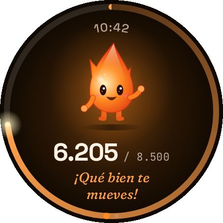
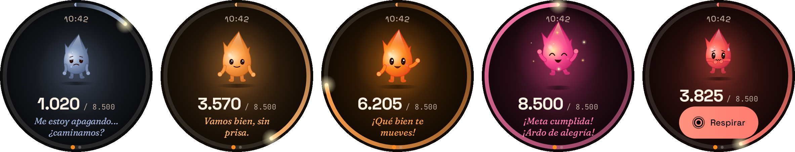
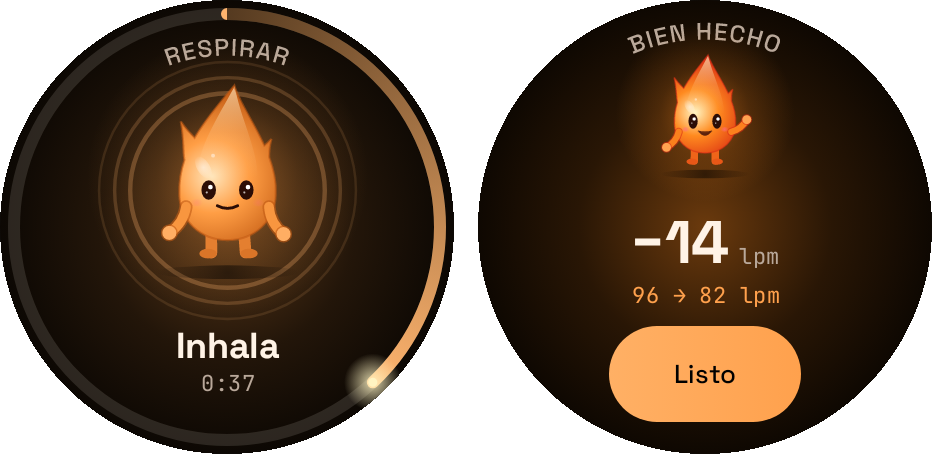
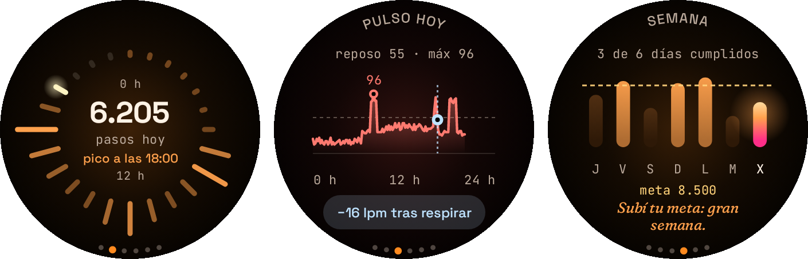
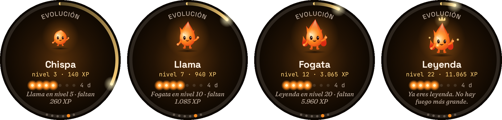
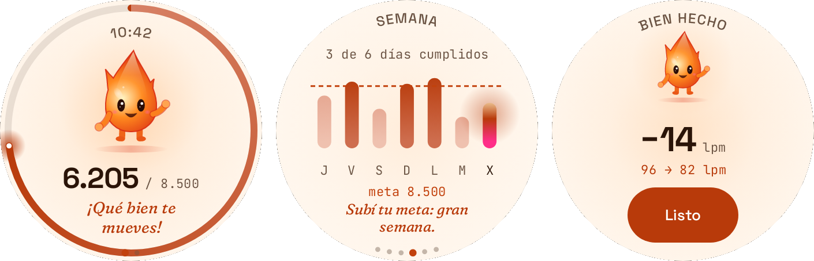

# Brasa

**Una mascota de fuego que vive en tu reloj y te dice, sin números ni sermones, si toca moverte, calmarte o descansar.**

App para **Wear OS** (Kotlin + Compose for Wear OS) · versión **1.0.0** · proyecto de la asignatura *Diseño de Interfaces*.



## El problema
Los relojes inteligentes miden mucho y explican poco: anillos, porcentajes y gráficas que hay que interpretar en una pantalla de 3 cm. La gente deja de mirarlos. Además, un pulso alto puede ser ejercicio o puede ser tensión, y el reloj no distingue.

## La propuesta
Brasa convierte los datos en **una emoción que se entiende de un vistazo**. Lee tus pasos y tu pulso y reacciona:



| Emoción | Cuándo | Qué te pide |
|---|---|---|
| Apagada | menos del 20 % de la meta o 3 h sin moverte | caminar un poco |
| Tranquila | 20–60 % de la meta | nada: vas bien |
| Feliz | 60–99 % | seguir así |
| Eufórica | meta cumplida | celebrar (vibración) |
| Inquieta | pulso alto **en reposo** (señal de tensión) | respirar un minuto con ella |

Cada emoción se distingue por **forma y gesto**, no solo por color (brazos caídos, manos a la boca, saludo, brazos arriba).

## Funciones
- **Inicio**: Brasa, la hora, los pasos contra la meta (anillo en el borde) y su frase. Tocarla la hace reír.
- **Respirar**: un minuto guiado (4 s inhalar · 6 s exhalar) en el que Brasa se infla y se desinfla, con vibraciones de ritmo y el pulso antes/después.
  
- **Gráficas**: pasos por hora (radial), pulso del día con la respiración marcada y semana contra la meta adaptativa.
  
- **Evolución**: Brasa crece con tu constancia — Chispa (nivel 1–4), Llama (5–9), Fogata (10–19) y Leyenda (20+). Cada subida de nivel tiene su animación y vibración.
  
- **Meta adaptativa**: media de tus últimos 7 días + 5 %, con un cambio máximo de ±15 % al día.
- **Voz con IA**: en los momentos clave (tensión, inactividad, meta, subida de nivel, tras respirar) Brasa habla con frases de Gemini; sin red usa su propio banco de frases.
- **Ajustes**: tema oscuro/claro, idioma (español/inglés), modo demo y sensores.
  

## Cómo funciona
```
Reloj (Kotlin + Compose for Wear OS)                Servidor (Vercel)
┌───────────────────────────────────────┐           ┌──────────────────────────────┐
│ Health Services (pasos, pulso) ──┐    │  niveles  │ Zod (solo valores cerrados)  │
│ Reglas puras (domain/) ──────────┼──▶ │ ────────▶ │ Gemini 3.5 Flash-Lite        │
│ DataStore (todo se queda aquí)   │    │  ◀──────  │ respaldo local si falla      │
│ Banco de frases local (sin red) ─┘    │   frase   └──────────────────────────────┘
└───────────────────────────────────────┘
```
- Las **reglas** (emoción, tensión, XP, meta, celebraciones) son funciones puras en `app/.../domain/Reglas.kt`, probadas con JUnit.
- **Tensión** = media de los últimos 3 min ≥ tu pulso de reposo + 20 lpm **y** sin pasos en 5 min. Moverse con el pulso alto no es tensión.
- **XP** = 1 por cada 100 pasos + 10 por respiración. **Nivel** = 1 + ⌊√(XP/25)⌋.

## Privacidad
- Pasos y pulso exactos **nunca salen del reloj**. Al servidor solo viajan niveles (`bajo`/`medio`/`alto`), la emoción, la etapa y un id aleatorio sin cuenta ni nombre. El servidor rechaza cualquier campo de más (por ejemplo `pulso: 112`) con un error 400.
- **Sin cuentas propias**: no hay registro ni contraseñas.
- No es un dispositivo médico: Brasa habla de "señales de tensión", nunca de diagnósticos.

## Continuidad al cambiar de reloj
Brasa usa la **copia de seguridad de Google** del propio usuario (Android Auto Backup). Solo se respalda un almacén aparte con los ajustes y el progreso (XP total, respiraciones, meta). Al restaurar en otro reloj, Brasa vuelve con el mismo nivel y la misma meta; los datos de salud, el historial por día y el id del reloj no se copian, y los permisos se vuelven a pedir.

## Funciona siempre
Sin internet, sin servidor o con `SERVER_URL` vacío la app funciona igual: el cliente HTTP nunca lanza, corta a los 3 s de conexión y Brasa usa sus frases locales (probado en `ServidorSinRedTest` y en el emulador en modo avión).

## Tecnologías
| Parte | Tecnología |
|---|---|
| App | Kotlin 2.3.20 · Compose BOM 2026.03.01 · Wear Compose Material 3 1.7.1 · Health Services 1.1.0 · DataStore 1.3.0 · AppCompat 1.8.0 · kotlinx.serialization 1.12.0 |
| Build | AGP 9.1.1 · Gradle 9.3.1 · minSdk 30 · targetSdk 36 · compileSdk 37 · app independiente (standalone) |
| Pruebas app | JUnit 4 · Robolectric 4.17 · Roborazzi 1.77.0 · Compose UI Test |
| Servidor | TypeScript · Vercel Functions (Node.js) · `@google/genai` 2.32.0 (`gemini-3.5-flash-lite`) · Zod 4.6.7 · `node:test` |
| Diseño | Canvas propio sin `Modifier.blur` (brillos con degradados radiales) · Space Grotesk, Fraunces y JetBrains Mono (OFL) |

## Ejecutarla
**Requisitos**: Android Studio (JBR 17+), SDK de Android, AVD de Wear OS (redondo grande, API 34).

```bash
# 1. Servidor (opcional: la app funciona sin él). Ya desplegado en:
#    https://brasa-servidor.vercel.app   (ver servidor/README.md para desplegar el tuyo)
# 2. local.properties en la raíz:
#    sdk.dir=…            (lo crea Android Studio)
#    SERVER_URL=https://brasa-servidor.vercel.app
./gradlew :app:assembleDebug
emulator -avd Brasa_Wear_Redondo
adb install -r app/build/outputs/apk/debug/app-debug.apk
adb shell cmd locale set-app-locales com.brasa.app --locales es   # app en español
```
En el emulador los sensores pasivos no siempre dan datos: activa **Ajustes → Modo demo** o usa el simulador de la versión debug:
```bash
adb shell am broadcast -a com.brasa.app.SIMULAR -p com.brasa.app --ei pasos 6500   # pasos de hoy
adb shell am broadcast -a com.brasa.app.SIMULAR -p com.brasa.app --ei pulso 112    # pulso alto en reposo
```

## Pruebas
```bash
./gradlew :app:testDebugUnitTest          # 170 pruebas: reglas, interfaz, accesibilidad, sin servidor y capturas
./gradlew :app:verifyRoborazziDebug       # compara las 128 capturas con docs/capturas/roborazzi/
cd servidor && npm test                   # 17 pruebas: validación, datos exactos rechazados, Gemini simulado, fallos de red
```

## Documentación
- [Justificación de diseño](docs/justificacion-diseno.md) (Nielsen, Gestalt, Fitts, WCAG)
- [Dirección de arte](docs/direccion-de-arte.md) · [Revisión visual](docs/revision-visual.md) · [Sensores](docs/sensores.md)
- [QA](docs/QA.md) · [Guion de la demo](docs/demo-profesor.md) · [Servidor](servidor/README.md)

## Estado
Versión 1.0.0 terminada: todas las pantallas, servidor desplegado, pruebas en verde. Pendiente (fuera de alcance): resumen del día con IA en el reloj (el servidor ya tiene `/api/resumen`), datos con la app cerrada (`PassiveListenerService`), almacenamiento persistente del servidor (Upstash) y tile de Wear OS.
